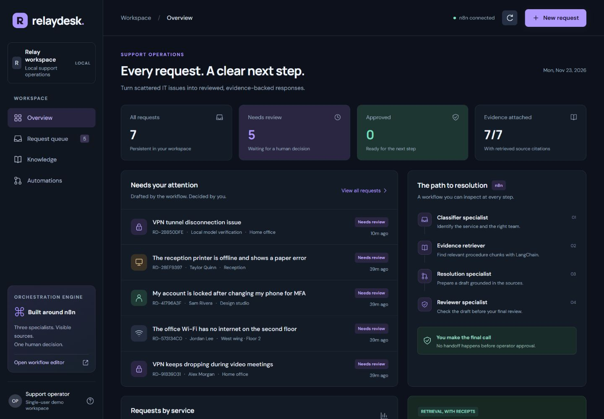

# RelayDesk

**A voice-enabled IT support workbench, orchestrated in n8n.**

Employees describe an issue in the browser. Three specialist AI agents classify it, retrieve procedures, draft a sourced response and review it. An operator inspects the evidence, edits the response and approves an internal handoff. The queue, sources, agent summaries and approval history remain inspectable.

This is an original capstone with a built-in browser portal. It needs no Telegram or messaging account. The optional email workflow is disabled until you configure a mailbox.



## Start on Windows

Prerequisites: Docker Desktop running with Linux containers, Docker Compose, and Node.js 22 or newer. Python is required only for native development/tests, not the containerized demo. First startup downloads images and Python packages.

From this project directory:

```powershell
pwsh -File .\scripts\start.ps1
```

On macOS/Linux:

```sh
sh scripts/start.sh
```

Open the [support portal](http://localhost:18080) and [n8n editor](http://localhost:15678). Create your own n8n owner account on first opening the editor. The setup script imports and publishes the two core workflows before startup; the portal does not require an n8n editor login.

The launcher creates an ignored `.env` with random local keys, imports credentials without printing them, builds the service and checks container health. Re-running it preserves existing workflow edits and optional email configuration. A persistent marker resumes an interrupted first import/publication. It never resets your volumes.

If ports are occupied, edit `RELAYDESK_PORT` and `RELAYDESK_N8N_PORT` in `.env`, then run the launcher again. The portal's editor links and launcher output use those settings.

## Try the complete journey

1. Choose **New request**, enter your location, select **VPN drops**, and use **Demo** mode.
2. Open **Evidence** to read the retrieved procedure and **Agent trail** to inspect the actual workflow stages. Demo mode is deterministic and does not call an LLM.
3. Review or edit the answer, then select **Approve response**.
4. In **Automations**, select **Run pending handoffs**. n8n records one internal receipt. No external email, chat message or privileged IT action is sent.
5. Reopen the approved request, add a resolution note and select **Mark resolved**.
6. In **Knowledge**, search for a procedure or add one. Custom sources are unreviewed by default; explicitly review a procedure before marking it trusted.

The four seeded requests are visibly labeled sample fixtures. Submitting a new request executes n8n. Try an unsupported question to see abstention, or omit a location through the API to see blocked handoff.

## Use real local LLMs

The default demo requires no model. For **Local LLM** mode, install/start Ollama and pull the configured model:

```sh
ollama pull llama3.2:3b
```

The default container connection is `http://host.docker.internal:11434`. If your Ollama installation accepts only loopback traffic and Docker cannot reach it, configure a reachable local address in `.env`. Use the isolated container profile below if you prefer not to change the host model service's network binding.

Optional model container:

```sh
docker compose --profile local-model up -d ollama
docker compose exec ollama ollama pull llama3.2:3b
```

Then set `RELAYDESK_OLLAMA_URL=http://ollama:11434` in `.env` and rerun the launcher to update service configuration and credentials. This profile uses CPU by default. The model download is roughly 2 GB; model weights are not in the source ZIP. The full optional-model profile was not used in the recorded verification; the already-running host Ollama service was used.

Change `RELAYDESK_OLLAMA_MODEL` to another compatible tool-capable model if desired. Small models can return invalid schemas or references. Such runs have visible fallback/findings and cannot authorize a handoff. One successful local run is documented; it is not a quality benchmark.

## Where the requested technologies are used

| Technology | Concrete implementation |
|---|---|
| n8n automation | Main intake/agent canvas, approved handoff canvas and optional email intake |
| Multi-agent system | Native n8n classifier, resolver and reviewer AI Agent nodes, each with a read-only procedure tool and its own model connection |
| LangChain | n8n's native LangChain agents/Ollama nodes; Python BaseRetriever and Document objects |
| RAG | BM25 retrieval over chunked procedures, source IDs/excerpts, structured citations and no-evidence abstention |
| LLM | Local Ollama model in Live mode; real model execution verified |
| Docker | n8n and data/portal containers, persistent volumes, health checks, optional Ollama container |
| Text to speech | **Read aloud** in a ticket response, using the browser/OS voice engine |
| Speech to text | Optional **Dictate request**, feature-detected Web Speech recognition |
| Messaging alternative | Built-in web/voice portal; optional IMAP email intake, no Telegram |
| Human review | Editable responses, version-checked approval, durable outbox and audit history |

Retrieval is deliberately lexical; no embeddings, vector database or semantic-search quality is claimed. These are bounded specialist agents in a workflow, not an unconstrained autonomous IT administrator.

## Open and edit the n8n workflows

- [`workflows/01-intake.json`](workflows/01-intake.json): authenticated webhook → classification → retrieval → resolution → review → guard → ticket.
- [`workflows/02-handoff.json`](workflows/02-handoff.json): approved outbox → idempotent internal receipts.
- [`workflows/03-email-optional.json`](workflows/03-email-optional.json): IMAP batch → normalized requests → same core pipeline. Disabled initially.

Edit directly in n8n; normal startup preserves those edits. To intentionally replace the **core** workflows with the tracked source versions:

```sh
node scripts/build-workflows.mjs
docker compose stop n8n
docker compose run --rm --no-deps --entrypoint node n8n /opt/relaydesk/scripts/n8n-init.mjs --refresh-core
docker compose up -d --wait desk n8n
```

`--refresh-core` leaves the optional email workflow alone. Export any canvas edits you want to keep before replacing the core workflows. The generator embeds the tested functions from `workflows/logic.mjs` in the Code nodes, so the project requires no custom/community node installation.

For optional email, choose an IMAP credential in **Support mailbox**, configure a dedicated inbox, set a unique `RELAYDESK_MAILBOX_NAMESPACE` if you use multiple mailboxes, then publish that workflow yourself. Every item in an IMAP batch is converted. Email requests have no verified location and remain blocked pending a corrected request. IMAP delivery/retry behavior depends on the provider and n8n trigger; this is not a guaranteed-delivery mailbox system. No outbound email workflow is enabled.

## Tests and evaluation

Install [uv](https://docs.astral.sh/uv/) for native Python development:

```sh
uv sync --locked
uv run pytest --basetemp=.cache/pytest --cov=app
node --test tests/workflow.test.mjs
```

Create `.cache` first if it does not exist. The explicit test temp directory avoids an inaccessible system temp path on the build machine.

With the Docker stack running, these checks create synthetic tickets and handoffs:

```sh
uv run python scripts/smoke.py --live
uv run python scripts/verify-boundaries.py
```

Results, exact scope and limitations: [verification](docs/VERIFICATION.md), [evaluation](docs/EVALUATION.md), [machine-readable results](docs/evaluation-results.json), [boundary checks](docs/boundary-results.json).

## Data and access

The portal is a local single-user development workspace; ports bind to `127.0.0.1`. Set `RELAYDESK_PORTAL_KEY` for an additional shared-key gate. It is not a production login or tenant-isolation system.

Ingress uses signed 30-second JWTs, so the reusable service secret is not sent to webhook triggers. Limited secret redaction occurs before the request enters n8n and again in the workflow. Full execution/progress retention is disabled, but the pinned n8n version still retains minimal trigger data; do not put sensitive information in reports. Optional IMAP trigger data can include raw mail. Pattern redaction cannot detect every secret.

`.env`, credentials, local databases and model weights are excluded from the source archive. Keep a private backup of `.env` and the named volumes; the encryption key is required to recover n8n credentials. **Do not delete volumes as a routine restart step.**

Stop the stack without deleting data:

```sh
docker compose stop
```

Resume it without reimporting or rebuilding:

```sh
docker compose up -d --wait desk n8n
```

## Handover material

- [Original problem statement, technical research and GitHub references](docs/RESEARCH.md)
- [Architecture and system boundaries](docs/ARCHITECTURE.md)
- [Design](docs/DESIGN.md), [staged plan](docs/PLAN.md), [build/review ledger](docs/BUILD_LOG.md)
- [Five-minute demo and viva notes](docs/DEMO.md)
- [Verification and remaining limits](docs/VERIFICATION.md)

Original RelayDesk code: MIT. n8n, Ollama, model weights and other dependencies retain their own licenses. The included support procedures are fictional demo material and need replacement before use with real employees.
