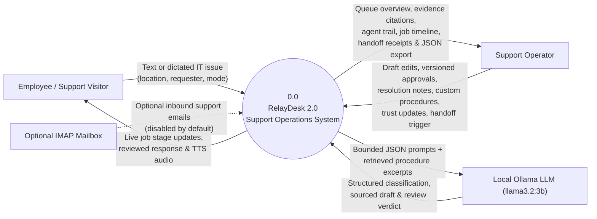
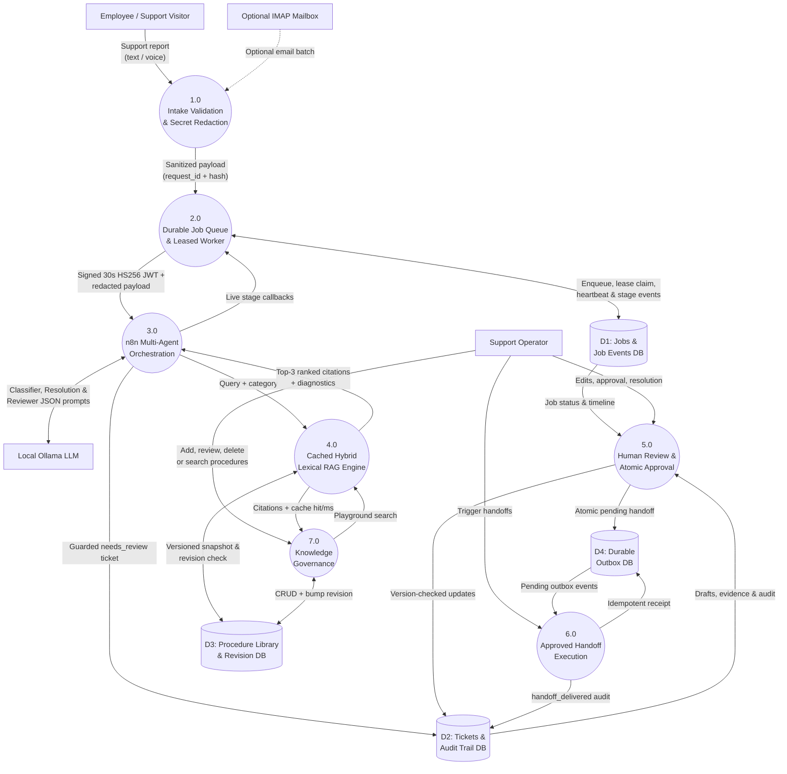

# RelayDesk 2.0

[](pyproject.toml)
[](pyproject.toml)
[](app/main.py)
[](compose.yaml)
[](app/retrieval.py)
[](#use-real-local-llms)
[](LICENSE)

**A voice-enabled, human-in-the-loop IT support operations workbench orchestrated in n8n, powered by a durable background worker, cached hybrid lexical RAG, and local multi-agent LLMs.**

Employees describe an IT issue by typing or dictating in the browser. Requests enter a durable SQLite job queue, are dispatched by an independent Docker worker with lease recovery and bounded retries, and flow through **three native n8n specialist AI agents** (**Classifier**, **Resolution**, and **Reviewer**) that stream live stage progress back to the console. An operator inspects the retrieved evidence, agent trail, and job timeline, edits the response, and approves an atomic internal handoff.

This is an original capstone with a built-in browser/voice portal — it requires no Telegram or third-party chat account. The optional IMAP email workflow remains disabled until configured.


---

## Key Features

- **n8n-First Multi-Agent Orchestration:** Three native n8n LangChain Tools Agent nodes (`Classifier`, `Resolution`, `Reviewer`), each with its own Ollama chat-model connection, bounded iteration cap, and read-only procedure-search tool.
- **Durable Background Job Queue & Independent Worker:** SQLite-backed job queue (`app/jobs.py`) and dedicated `worker` container (`app/worker.py`) with lease tokens, heartbeats, expired-lease reclamation + audit events, exponential retry backoff, and a **Job Timeline** inspector modal.
- **Cached Hybrid Lexical RAG:** Versioned LangChain `BaseRetriever` (`app/retrieval.py`) combining `BM25Okapi` + character 3-gram cosine similarity via Reciprocal Rank Fusion (RRF), 128-entry LRU query cache (**6.7× measured speedup**), and automatic cache invalidation on knowledge edits.
- **Knowledge Governance:** Built-in **Retrieval Playground** with service filters and live latency/cache diagnostics, plus custom procedure ingestion, explicit **Mark reviewed / Mark unreviewed** trust toggling (`PATCH /api/knowledge/{id}`), and two-click removal (`DELETE /api/knowledge/{id}`).
- **Human-in-the-Loop Atomic Approval & Outbox:** Optimistic version checks and `BEGIN IMMEDIATE` SQLite transactions guarantee exactly one durable outbox event per approved ticket, processed into idempotent internal receipts by n8n.
- **Voice-Enabled Browser Portal:** Feature-detected Web Speech API dictation (`Dictate request`) and browser speech synthesis (`Read aloud`), quick status triage pills, live n8n connection handshake probe, and full workspace JSON export.
- **Defense-in-Depth Safety Boundaries:** Pre-ingress secret redaction, 30-second HS256 JWTs for webhook ingress, prompt-injection detection, physical-hazard safety withholding, hallucinated-citation rejection, and optional shared portal key (`X-Portal-Key`).

---

## Data Flow Diagrams (DFD)

> Full Level 0, Level 1, and Level 2 DFD specifications and data dictionary are available in [**`docs/DFD.md`**](docs/DFD.md) and [**`docs/ARCHITECTURE.md`**](docs/ARCHITECTURE.md).

### Level 0 DFD — Context Diagram



### Level 1 DFD — System Decomposition



---

## Technology Stack

| Technology | Concrete Implementation |
|---|---|
| **n8n automation** | Main intake/agent canvas (`01-intake`), approved handoff canvas (`02-handoff`), authenticated connection probe (`04-status`), and optional email intake (`03-email-optional`) |
| **Multi-agent system** | Native n8n Classifier, Resolution, and Reviewer AI Agent nodes, each with a read-only procedure tool and its own Ollama model connection |
| **Durable job queue** | SQLite WAL job queue with independent Docker worker, heartbeats, lease expiration recovery, exponential backoff, and live n8n stage callbacks |
| **LangChain** | n8n's native LangChain Agent/Ollama nodes; Python `BaseRetriever` and `Document` objects |
| **Hybrid Lexical RAG** | Versioned, cached BM25 + character 3-gram similarity (Reciprocal Rank Fusion), stable source IDs, structured citations, automatic cache invalidation, and no-evidence abstention |
| **Local LLM** | Local Ollama (`llama3.2:3b`) in Live mode; deterministic rule-based Demo mode available with zero model setup |
| **Docker** | `desk`, `worker`, and `n8n` containers, named persistent volumes, health checks, and optional `ollama` container profile |
| **Voice (STT / TTS)** | Optional browser Web Speech dictation (`Dictate request`) and browser/OS speech synthesis (`Read aloud`) |
| **Human Review** | Editable responses, optimistic version-checked approvals, durable outbox, custom procedure trust review/removal, and immutable audit history |

> Retrieval is deliberately lexical; no vector database or semantic-embedding claims are made. Specialist agents are bounded workflow actors with read-only tools, never autonomous IT administrators.

---

## Project Structure

```text
relaydesk/
├── app/
│   ├── main.py              # FastAPI app factory, security middleware, REST & internal endpoints
│   ├── store.py             # SQLite WAL persistence (tickets, audit, outbox, knowledge, revision)
│   ├── jobs.py              # Durable job queue, lease tokens, reclamation, retries, stage events
│   ├── worker.py            # Independent async background worker container entrypoint
│   ├── retrieval.py         # Versioned, cached LangChain HybridRetriever (BM25 + 3-gram RRF)
│   ├── operations.py        # Authenticated n8n connection probe & Ollama health snapshots
│   ├── security.py          # Pre-ingress secret redaction & 30-second HS256 JWT envelope
│   ├── transport.py         # Shared authenticated HTTP client for n8n webhooks
│   ├── schemas.py           # Strict Pydantic v2 request/response contracts
│   ├── corpus.py            # Fictional IT support demo procedures & sample tickets
│   ├── config.py            # Pydantic settings loaded from environment / .env
│   └── static/              # Single-page portal (index.html, app.js, v2.css, mark.svg)
├── workflows/
│   ├── logic.mjs            # Tested pure JS business/guard logic embedded into n8n Code nodes
│   ├── 01-intake.json       # Core intake, 3 specialist agents, policy guard & stage callbacks
│   ├── 02-handoff.json      # Approved outbox polling & idempotent internal receipt recording
│   ├── 03-email-optional.json # Optional IMAP inbox intake (disabled by default)
│   └── 04-status.json       # Authenticated website-to-n8n connection handshake probe
├── scripts/
│   ├── start.ps1 / start.sh # One-command Windows & macOS/Linux launchers
│   ├── configure.mjs        # Generates local .env keys without printing secrets
│   ├── build-workflows.mjs  # Compiles workflows/logic.mjs into all 4 n8n workflow JSONs
│   ├── n8n-init.mjs         # Imports credentials & safely publishes core workflows
│   ├── v2-smoke.py          # End-to-end website → worker → n8n (Demo & Live) verification
│   ├── smoke.py             # 10-case routing, lifecycle & safety verification
│   └── verify-boundaries.py # 4000-char, hazard, redaction, expired JWT & concurrency checks
├── tests/
│   ├── test_service.py      # FastAPI, SQLite, RAG, auth, knowledge governance & security tests
│   ├── test_jobs.py         # Durable queue, concurrency, lease expiry & worker tests
│   └── workflow.test.mjs    # Node unit tests for workflow logic, guards & bootstrap recovery
├── docs/
│   ├── DFD.md               # Level 0, Level 1 & Level 2 Data Flow Diagrams + data dictionary
│   ├── ARCHITECTURE.md      # System boundaries, retrieval, approval semantics & guard limits
│   ├── V2-PLAN.md           # RelayDesk 2.0 upgrade plan & review focus
│   ├── VERIFICATION.md      # Full automated, live integration & browser verification record
│   ├── EVALUATION.md        # Evaluation methodology & results
│   ├── DEMO.md              # Five-minute live demonstration & viva Q&A guide
│   └── screenshots/         # Desktop, mobile & agent-trail reference captures
├── compose.yaml             # Docker Compose stack (desk, worker, n8n, optional ollama)
├── Dockerfile               # Multi-stage uv + Python 3.12 slim container image
├── pyproject.toml           # Python 3.12 dependencies & pytest/coverage config
└── package.json             # Node workflow build & test scripts
```

---

## Quick Start

### Prerequisites
- **Docker Desktop** (Linux containers) & **Docker Compose**
- **Node.js 22+**
- *(Optional)* **Ollama** for Local LLM mode; **Python 3.12 + `uv`** only for running native unit tests outside Docker

### Start on Windows (PowerShell)

```powershell
pwsh -File .\scripts\start.ps1
```

### Start on macOS / Linux

```sh
sh scripts/start.sh
```

Open:
- **Support Portal:** [http://localhost:18080](http://localhost:18080)
- **n8n Workflow Editor:** [http://localhost:15678](http://localhost:15678) *(create your local n8n owner account on first visit; core webhooks are pre-published and the portal does not require n8n editor login)*

The launcher generates an ignored `.env` with random local keys, imports encrypted credentials into n8n without printing secrets, builds the service image, starts `desk`, `worker`, and `n8n`, and waits until all containers report healthy. Re-running it preserves your volumes, tickets, and workflow edits.

> **Custom ports:** Edit `RELAYDESK_PORT` and `RELAYDESK_N8N_PORT` in `.env`, then re-run the launcher.

### Stop / Resume Without Losing Data

```sh
# Stop cleanly (preserves all SQLite & n8n Docker volumes)
docker compose stop

# Resume quickly without rebuilding or reimporting
docker compose up -d --wait desk n8n worker
```

---

## Try the Complete Journey

1. Click **New request**, enter a location, select **VPN drops**, and choose **Demo** (or **Local LLM** if Ollama is ready).
2. Watch the live durable job stages reported back from n8n (`Queued → Classifying → Retrieving → Drafting → Persisting`).
3. Open **Evidence** to inspect the cited procedure chunk and **Agent trail** to inspect each workflow stage.
4. Edit the draft if desired and click **Approve response** (atomically queues one outbox handoff).
5. Go to **Workflows**, inspect the authenticated n8n handshake, click **Timeline** on any job to inspect its full stage event log, and click **Run handoffs** to record an idempotent internal receipt.
6. Reopen the approved request, enter a resolution note, and click **Mark resolved**.
7. Go to **Knowledge** to test the **Retrieval Playground** (observe `Fresh query` → `Cache hit` diagnostics) or add a custom procedure and manage its trust with **Mark reviewed / Mark unreviewed** and **Remove**.

---

## Use Real Local LLMs (Ollama)

Demo mode works out of the box with no model. For **Local LLM** mode (3 live specialist agents):

```sh
ollama pull llama3.2:3b
```

By default Docker connects to your host Ollama at `http://host.docker.internal:11434`. Alternatively, run the optional containerized Ollama profile:

```sh
docker compose --profile local-model up -d ollama
docker compose exec ollama ollama pull llama3.2:3b
```

Then set `RELAYDESK_OLLAMA_URL=http://ollama:11434` in `.env` and re-run the launcher. Change `RELAYDESK_OLLAMA_MODEL` to swap to another tool-capable Ollama model.

---

## API Reference

### Portal Endpoints (`/api/*` — loopback, optional `X-Portal-Key`)
| Method | Endpoint | Description |
|---|---|---|
| `GET` | `/api/health` | Cached operations snapshot (n8n handshake, worker heartbeat, Ollama readiness, RAG index stats) |
| `POST` | `/api/integrations/check` | Force live authenticated handshake with n8n (`RelayDeskStatus01`) and Ollama check |
| `POST` | `/api/jobs` | Enqueue a sanitized support report for durable worker processing (`202 Accepted`) |
| `GET` | `/api/jobs` / `/api/jobs/{id}` | List recent jobs & worker metrics, or inspect a job with its full stage event timeline |
| `POST` | `/api/jobs/{id}/retry` | Requeue a failed job for another bounded 3-attempt retry cycle |
| `GET` | `/api/tickets` / `/api/tickets/{id}` | List tickets or retrieve a ticket with citations, agent trail, and audit history |
| `POST` | `/api/tickets/{id}/approve` | Optimistic version-checked approval; atomically creates one pending outbox event |
| `POST` | `/api/tickets/{id}/resolve` | Mark an approved ticket resolved with an operator resolution note |
| `GET` / `POST` | `/api/knowledge` | List all procedures or add a custom procedure (unreviewed by default) |
| `PATCH` / `DELETE` | `/api/knowledge/{id}` | Mark a custom procedure reviewed/unreviewed or delete it (invalidates RAG cache) |
| `POST` | `/api/knowledge/search` | Query the cached hybrid lexical RAG engine and return ranked citations + diagnostics |
| `GET` | `/api/outbox` | List recent outbox handoff events and pending count |
| `POST` | `/api/automations/run` | Trigger the n8n approved handoff workflow (`02-handoff.json`) |
| `GET` | `/api/export` | Export full workspace JSON (tickets, audit trail, outbox, and knowledge library) |

### Internal Service Endpoints (`/internal/*` — requires `X-Relay-Key`)
`POST /internal/jobs/progress`, `POST /internal/retrieve`, `POST /internal/tickets`, `POST /internal/email-report`, `GET /internal/handoff/pending`, `POST /internal/handoff/receipt`.

---

## Open and Edit the n8n Workflows

- [`workflows/01-intake.json`](workflows/01-intake.json): authenticated webhook → validate/redact → classification → hybrid retrieval → resolution → review → policy guard → ticket + live progress callbacks.
- [`workflows/02-handoff.json`](workflows/02-handoff.json): approved outbox → idempotent internal support receipts.
- [`workflows/03-email-optional.json`](workflows/03-email-optional.json): optional IMAP batch → normalized requests → core pipeline (disabled by default).
- [`workflows/04-status.json`](workflows/04-status.json): authenticated website-to-n8n connection handshake probe.

Ordinary startup preserves edits you make directly in the n8n canvas. To intentionally reset the **core** workflows back to tracked source versions (leaving optional email untouched):

```sh
node scripts/build-workflows.mjs
docker compose stop n8n
docker compose run --rm --no-deps --entrypoint node n8n /opt/relaydesk/scripts/n8n-init.mjs --refresh-core
docker compose up -d --wait desk n8n worker
```

---

## Testing, Benchmarks & Verification

Install [uv](https://docs.astral.sh/uv/) for native Python tests:

```sh
uv sync --locked
uv run pytest --basetemp=.cache/pytest --cov=app
node --test tests/workflow.test.mjs
```

Run live end-to-end integration and security boundary checks against the running Docker stack:

```sh
uv run python scripts/v2-smoke.py --live
uv run python scripts/smoke.py --live
uv run python scripts/verify-boundaries.py
```

### Verified Metrics
- **Automated Suites:** `29/29` Python tests passing (`86%` coverage) + `19/19` Node workflow tests passing.
- **Cached Retrieval Benchmark ([`docs/v2-benchmark.json`](docs/v2-benchmark.json)):** `6.7×` speedup (`0.98 ms` cached vs `6.63 ms` uncached average).
- **Live Integration ([`docs/v2-integration-results.json`](docs/v2-integration-results.json)):** Verified website → worker → n8n Demo (`~1.0 s`) and 3-agent Local LLM (`llama3.2:3b`, `~6.6 s`, zero fallback flags).
- **Boundary Suite ([`docs/boundary-results.json`](docs/boundary-results.json)):** Verified 4,000-char bounds, live hardware hazard blocking, pre-storage secret redaction, expired JWT rejection, and concurrent handoff idempotency.

---

## Security & Local Access Boundaries

- Ports bind strictly to `127.0.0.1` (local single-user workspace). Set `RELAYDESK_PORTAL_KEY` in `.env` for an optional shared-key gate (`X-Portal-Key`); this is not a multi-tenant production login system.
- Webhook ingress uses **30-second HS256 JWTs**; reusable secrets are never sent to n8n triggers.
- Limited secret redaction runs before enqueueing and again inside n8n; full execution retention is disabled (`saveDataSuccessExecution: "none"`, `saveDataErrorExecution: "none"`). Do not submit real passwords or sensitive personal data.
- Keep a private backup of `.env` and named Docker volumes (`desk_data`, `n8n_data`); `N8N_ENCRYPTION_KEY` is required to recover encrypted n8n credentials.

---

## Handover Documentation

- [Data Flow Diagrams — Level 0, Level 1 & Level 2 (DFD)](docs/DFD.md)
- [Architecture & System Boundaries](docs/ARCHITECTURE.md)
- [RelayDesk 2.0 Upgrade Plan](docs/V2-PLAN.md)
- [Verification Record & Limits](docs/VERIFICATION.md)
- [Evaluation Results](docs/EVALUATION.md)
- [Five-Minute Demo & Viva Q&A Guide](docs/DEMO.md)
- [Problem Research & References](docs/RESEARCH.md)
- [Design](docs/DESIGN.md), [Staged Plan](docs/PLAN.md), and [Build Ledger](docs/BUILD_LOG.md)

---

## License

Original RelayDesk code is licensed under the [MIT License](LICENSE). n8n, Ollama, model weights, and third-party dependencies retain their respective licenses. Included support procedures are fictional demo material and must be replaced before use with real employees.
