# Architecture and responsibility boundaries

```mermaid
flowchart LR
  User[Browser text or speech] --> Portal[RelayDesk portal / Jobs API]
  Portal --> Queue[(SQLite durable job queue)]
  Queue --> Worker[Independent Docker worker]
  Worker --> Hook[n8n authenticated intake webhook]
  Portal -.-> Probe[n8n status handshake webhook]
  Hook --> Validate[Validate and redact]
  Validate --> Mode{Demo or Live}
  Mode -->|Live| Classifier[Classifier AI Agent]
  Mode -->|Demo| Rules[Bounded routing rules]
  Classifier --> Retrieve[Retrieve procedure chunks]
  Rules --> Retrieve
  Retrieve --> RAG[Cached LangChain hybrid lexical index]
  RAG --> Knowledge[(Procedure library)]
  Retrieve --> Resolver[Resolution AI Agent or extractive demo]
  Resolver --> Reviewer[Reviewer AI Agent]
  Reviewer --> Guard[Deterministic policy guard]
  Guard --> Ticket[(SQLite needs_review ticket)]
  Ticket --> Human[Operator edits and approves]
  Human --> Outbox[(Atomic durable outbox)]
  Outbox --> Handoff[n8n approved handoff workflow]
  Handoff --> Receipt[(Idempotent internal receipt)]
  Model[Ollama chat model] -.-> Classifier
  Model -.-> Resolver
  Model -.-> Reviewer
```

The diagram shows the Live path. Demo mode skips the model stages and constructs an extractive draft; unsupported reports skip troubleshooting generation and are blocked from handoff. Evidence, decisions and trace summaries are inspectable in the portal.

## Service boundaries

| Component | Owns | Does not own |
|---|---|---|
| `01-intake.json` | Branching, three specialist agents, tool connections, retrieval ordering, live stage progress callbacks, draft validation, guard and persistence call | User identity or privileged IT actions |
| `02-handoff.json` | Reading approved pending events and recording idempotent receipts | Unapproved decisions or external notification by default |
| `03-email-optional.json` | Optional IMAP email-to-request conversion and core workflow invocation | Sender identity verification, approval or outbound email |
| `04-status.json` | Authenticated website-to-n8n connection handshake verification | Implying publication state of other workflows |
| Python service + worker | API contracts, durable SQLite job queue with leased worker recovery, versioned cached LangChain hybrid lexical retrieval, SQLite transactions, knowledge review governance and static portal | Specialist model calls or hidden fallback orchestration |
| Browser | Text/speech intake, evidence inspection, response editing, explicit approval | Silent approval or action on behalf of a resident/employee |

## Specialist agents

Each live role is a native n8n Tools Agent with its own Ollama chat-model connection, read-only procedure-search tool and prompt. The classifier and reviewer use native structured output parsers. The resolver uses JSON-mode generation plus an explicit typed validation boundary in the Code node, which proved more compatible with the small local model than a nested final-response tool. Known structured source IDs are formatted into inline citations; unknown IDs remain rejected. Maximum iterations are bounded. No agent has write access, shell execution, password-reset or account-management tools.

These are constrained specialists arranged in a workflow. They do not independently collaborate indefinitely, learn from approval outcomes, or prove that a cited instruction is semantically correct. Operator review is part of the product.

## Retrieval

Procedure text is chunked with a 160-character overlap and ranked by a versioned, cached hybrid lexical LangChain `BaseRetriever` combining `BM25Okapi` with character 3-gram cosine similarity via Reciprocal Rank Fusion (RRF), plus bounded domain synonym expansion. Category filtering narrows support scope. Any knowledge addition, review-trust update, or deletion atomically increments `knowledge_revision`, invalidating both the index and the 128-entry LRU query cache. Returned sources include stable IDs, titles, excerpts, review status, demo provenance, lexical rank score and measured search diagnostics. This is lexical RAG; no semantic embeddings or vector database are claimed. A future extension can compare embeddings against this measurable baseline.

## Approval and delivery semantics

- Intake request IDs are unique. Repeating the same normalized input returns the existing ticket; a conflicting reuse returns HTTP 409.
- Tickets begin in `needs_review`. Approval requires the current version, an eligible grounded draft and an operator response.
- A SQLite `BEGIN IMMEDIATE` transaction changes status and inserts exactly one durable outbox row for the ticket.
- The handoff workflow can retry pending events. The receipt endpoint serializes updates and writes one delivery audit entry per event.
- Local receipt handling is idempotent. External transport cannot generally promise exactly-once messaging; no such guarantee is claimed.
- Resolution requires a current approved version and an operator note. Audit rows retain the lifecycle.

## Local access and data

Operator ports bind to `127.0.0.1`. The default portal is a single-user local development workspace; set `RELAYDESK_PORTAL_KEY` for an additional shared-key boundary. This is not an employee login system or tenant isolation. Service-to-n8n ingress uses HS256 JWTs valid for 30 seconds. The reusable signing secret is not transmitted to the webhook. Calls back to the data service require a generated header key. n8n credentials are imported at runtime and encrypted using a separate generated encryption key. Workflow exports contain only credential references.

SQLite and n8n state use separate named Docker volumes. Keep `.env` with a private backup because the encryption key is required to recover n8n credentials. Full execution/progress retention is disabled and old executions are configured for pruning. The pinned n8n release still retains minimal trigger data, so limited secret redaction runs in the proxy before the webhook and again in n8n. Trigger metadata can retain an expiring JWT rather than the reusable secret. Optional IMAP trigger data can contain raw mail; use a dedicated test mailbox. No deliberate LangSmith tracing is enabled. Browser dictation can depend on a browser-provider service; no audio is uploaded to the RelayDesk backend.

## Guard limits

Input redaction and injection detection use bounded patterns. They are defense-in-depth and do not detect every secret or prompt injection. Structured schemas enforce shape, citation checks enforce known source IDs, and the reviewer adds a model check. None is a proof of semantic truth. Custom knowledge remains unreviewed by default and blocks handoff when retrieved. Only deliberately reviewed procedures should be trusted.
