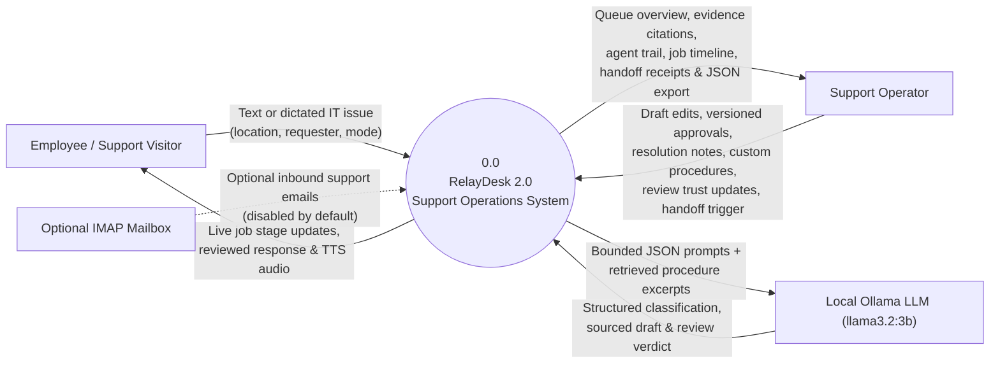
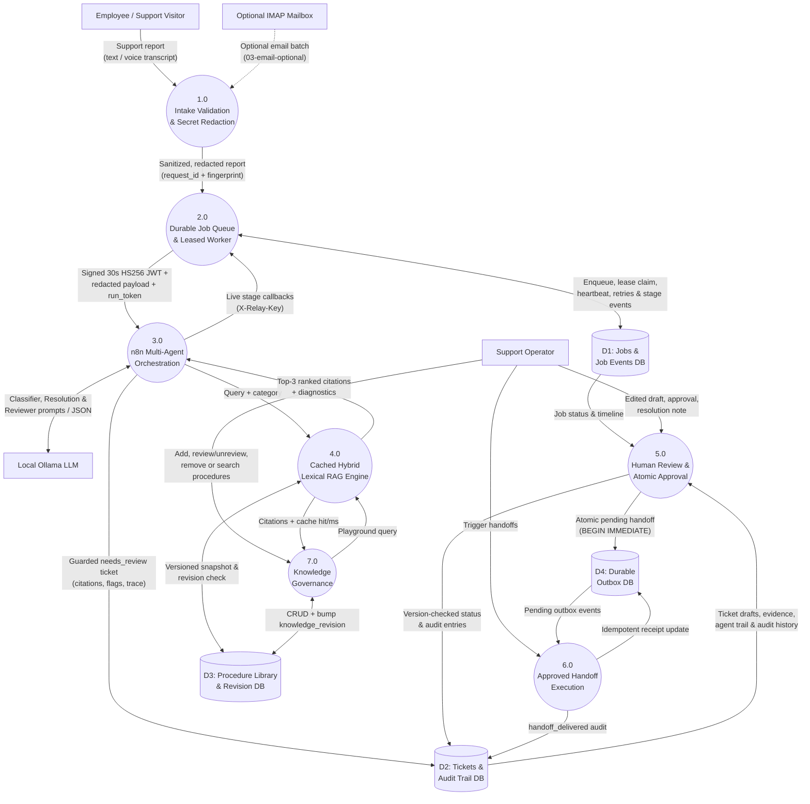
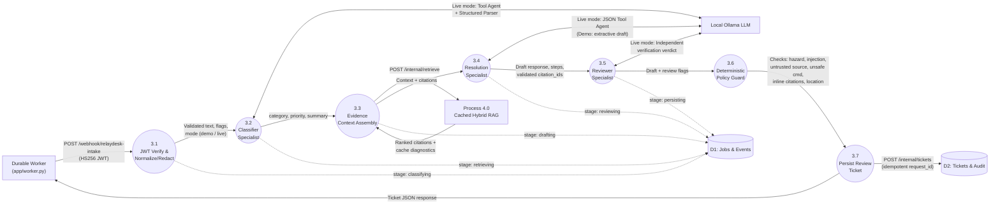
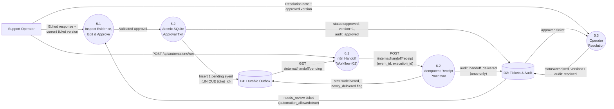

# RelayDesk 2.0 — Data Flow Diagrams (DFD)

This document defines the **Level 0 (Context)**, **Level 1 (System Overview)**, and **Level 2 (Process Decomposition)** Data Flow Diagrams for **RelayDesk 2.0**, along with its data stores and trust boundaries.

---

## Level 0 DFD — Context Diagram

The context diagram shows all external entities interacting with the RelayDesk 2.0 system boundary.

---

## Level 1 DFD — System Decomposition

The Level 1 DFD decomposes **RelayDesk 2.0** into seven core processes and four persistent SQLite data stores.

---

## Level 2 DFD — Process 3.0 (n8n Multi-Agent Intake Pipeline)

This diagram details the internal data flows inside [`workflows/01-intake.json`](../workflows/01-intake.json), including the deterministic Demo path, the 3-agent Local LLM path, safety guards, and live stage telemetry.

---

## Level 2 DFD — Processes 5.0 & 6.0 (Approval, Outbox & Idempotent Handoff)

---

## Data Dictionary & Trust Boundaries

### External Entities
| Entity | Role | Trust Level |
|---|---|---|
| **Employee / Support Visitor** | Submits IT issue reports via portal text or browser Web Speech dictation; receives reviewed response and optional TTS audio. | Untrusted input (redacted, length-bounded, injection-checked). |
| **Support Operator** | Inspects tickets, evidence, agent trails, and job timelines; edits drafts; approves/resolves tickets; governs custom knowledge procedures. | Local trusted operator (loopback + optional `X-Portal-Key`). |
| **Local Ollama LLM** | Provides local inference (`llama3.2:3b`) for Classifier, Resolution, and Reviewer n8n AI Agents in Live mode. | Untrusted output (schema-validated, citation-checked, policy-guarded). |
| **Optional IMAP Mailbox** | Optional disabled-by-default email intake (`03-email-optional.json`). | Untrusted input (no verified location; always blocked pending review). |

### Persistent Data Stores (SQLite WAL — `/data/relaydesk.db`)
| Store | Tables | Responsibility |
|---|---|---|
| **D1: Jobs & Job Events** | `jobs`, `job_events`, `workers` | Durable async dispatch queue, lease tokens, worker heartbeats, bounded retry schedule, and live stage event history. |
| **D2: Tickets & Audit Trail** | `tickets`, `audit` | Request deduplication (`request_id`, `input_hash`), optimistic versioning (`version`), lifecycle states (`needs_review` → `approved` → `resolved`), and immutable audit records. |
| **D3: Procedure Library & Revision** | `knowledge`, `metadata` | Built-in fictional procedures + custom operator procedures, review trust flags (`trusted`), and monotonic `knowledge_revision` counter for automatic RAG cache invalidation. |
| **D4: Durable Outbox** | `outbox` | Atomically queued post-approval handoff events (`UNIQUE ticket_id`), retry counts, n8n execution IDs, and idempotent delivery timestamps. |

### Key Security & Reliability Boundaries
1. **Pre-Ingress Redaction & Short-Lived JWTs:** Sensitive patterns (`password`, `passcode`, `recovery code`, `token`) are masked before enqueueing and again inside n8n. Service-to-n8n webhook requests use 30-second HS256 JWTs instead of transmitting reusable secrets.
2. **No Autonomous Action Tools:** Specialist agents only have a read-only procedure-retrieval tool. They cannot approve tickets, send external messages, unlock accounts, or run commands.
3. **Human-in-the-Loop Atomic Gate:** Approval requires matching `version`, `grounded=true`, non-empty `citations`, and `automation_allowed=true` inside a `BEGIN IMMEDIATE` SQLite transaction.
